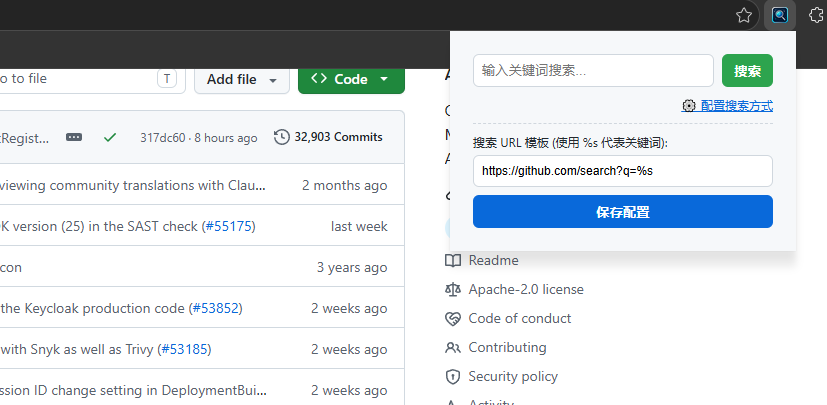

# 快速搜索 / Quick Search

一个轻量的浏览器扩展：点击工具栏图标，输入关键词，即可用你自定义的搜索引擎在新标签页中搜索。

> 支持 Microsoft Edge / Google Chrome（Manifest V3）。

## 功能

- 一键弹出搜索框，回车即搜
- 自定义搜索 URL 模板（`%s` 代表关键词）
- 配置保存在本地（`chrome.storage.local`），不上传任何数据
- 中英文界面（基于 `_locales`）
- 模板安全校验：仅允许 `http://` / `https://`

## 使用截图


## 安装

### 从商店安装

- Edge 加载项商店：`https://microsoftedge.microsoft.com/addons/detail/%E5%BF%AB%E9%80%9F%E6%90%9C%E7%B4%A2/dcbphjiekbcihdkidebkgalegbdphifp`

### 开发者模式加载（本地调试）

1. 下载或克隆本仓库
2. 打开 `edge://extensions`（Chrome 为 `chrome://extensions`）
3. 打开「开发人员模式」
4. 点击「加载解压缩的扩展」，选择仓库根目录
5. 点击工具栏图标即可使用

## 使用

1. 点击扩展图标，输入关键词，按回车或点击「搜索」
2. 点击「⚙️ 配置搜索方式」可修改搜索 URL 模板
3. 模板中 `%s` 会被替换为 URL 编码后的关键词，例如：
   - GitHub：`https://github.com/search?q=%s`
   - Bing：`https://www.bing.com/search?q=%s`
   - Google：`https://www.google.com/search?q=%s`

## 目录结构

```text
my-search-extension/
├── .github/workflows/release.yml   # 打 tag 自动打包并发布 Release
├── _locales/                       # 国际化文案
│   ├── en/messages.json
│   └── zh_CN/messages.json
├── assets/                         # 图标（见 assets/README.md）
├── docs/privacy.html               # 隐私政策（GitHub Pages 托管）
├── scripts/
│   ├── generate_icons.py           # 从源图生成图标
│   └── package.py                  # 白名单打包脚本
├── manifest.json
├── popup.html
├── popup.js
├── CHANGELOG.md
├── LICENSE
└── README.md
``` 

## 开发

### 生成图标

```bash
pip install Pillow
# 将源图放到 assets/source.png {#将源图放到-assetssourcepng  data-source-line="724"}
python scripts/generate_icons.py
``` 

会生成 `assets/icon16/32/48/128/300.png`。请将这些产物提交到仓库。

### 打包

```bash
python scripts/package.py
``` 

产物：`dist/my-search-extension-<version>.zip`，可直接上传到 Edge 加载项商店。
打包采用**白名单**策略，只包含扩展运行必需的文件。

### 发布新版本

1. 更新 `manifest.json` 中的 `version`
2. 更新 `CHANGELOG.md`
3. 提交并打 tag：

   ```bash
   git tag v1.0.1
   git push origin v1.0.1
   ``` 

4. GitHub Actions 会自动打包并把 zip 附到 Release

## 隐私

本扩展不收集任何用户数据。详见 [隐私政策](https://github.com/zhouyp001/my-search-extension/blob/main/docs/privacy.html)
（也可通过 GitHub Pages 访问）。

## 贡献

欢迎提交 Issue 和 Pull Request。

## 许可证

[MIT](LICENSE) © zhouyp001